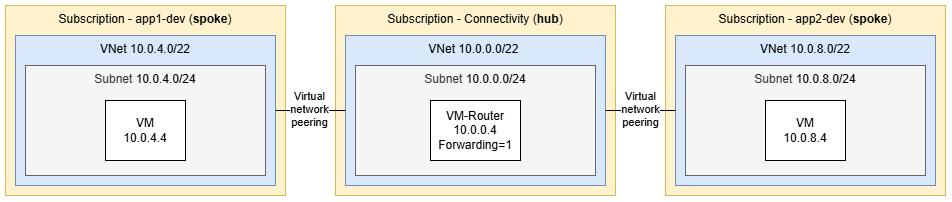

# Minimal hub-spoke topology in Azure via Bicep

Minimal hub-spoke network in Azure, built with Bicep and Azure Verified Modules (AVM). One hub VNet with a Linux VM router and two spoke VNets peered to the hub. Traffic between the spokes is routed through the hub.



## Prerequisites

```powershell
winget install --exact --id Microsoft.AzureCLI
az bicep upgrade
```

The three subscriptions (connectivity, app1-dev, app2-dev) must already exist. Bicep does not create them.

## Deploy

```powershell
ssh-keygen -t ed25519 -f "$HOME\.ssh\azure-hub-spoke-template-01" -C "azure-hub-spoke-template-01"
$env:ADMIN_SSH_PUBLIC_KEY = Get-Content "$HOME\.ssh\azure-hub-spoke-template-01.pub"

az login --tenant '<tenant-id>'

# Hub
az account set --subscription '<hub-subscription-id>'
az deployment sub create -n hub-shared -l swedencentral -f platform/connectivity/main.bicep -p platform/connectivity/params/shared.bicepparam

# Update subscriptionId in platform/hub.bicep, then deploy the spokes.

# Spoke app1
az account set --subscription '<app1-subscription-id>'
az deployment sub create -n spoke-app1-dev -l swedencentral -f landing-zones/main.bicep -p landing-zones/app1/dev.bicepparam

# Spoke app2
az account set --subscription '<app2-subscription-id>'
az deployment sub create -n spoke-app2-dev -l swedencentral -f landing-zones/main.bicep -p landing-zones/app2/dev.bicepparam
```

## Test connectivity

```powershell
az vm run-command invoke -g rg-spoke-app1-dev -n vm-conntest-app1-dev-swedencentral-001 --command-id RunShellScript --scripts "ping -c 4 10.0.8.4; tracepath -n 10.0.8.4"
```

## Clean up

Run each command in the subscription that contains the resource group.

```powershell
az group delete -n rg-spoke-app1-dev --yes
az group delete -n rg-spoke-app2-dev --yes
az group delete -n rg-hub-shared --yes
```
